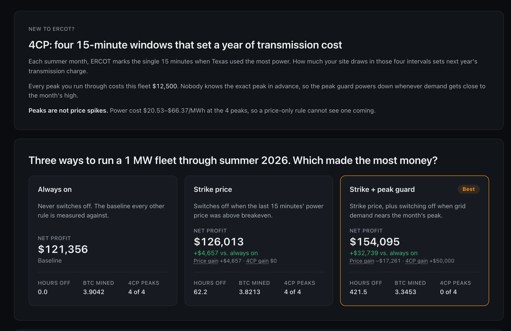
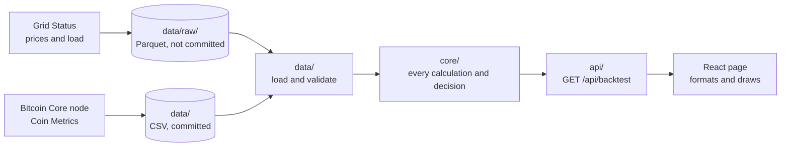
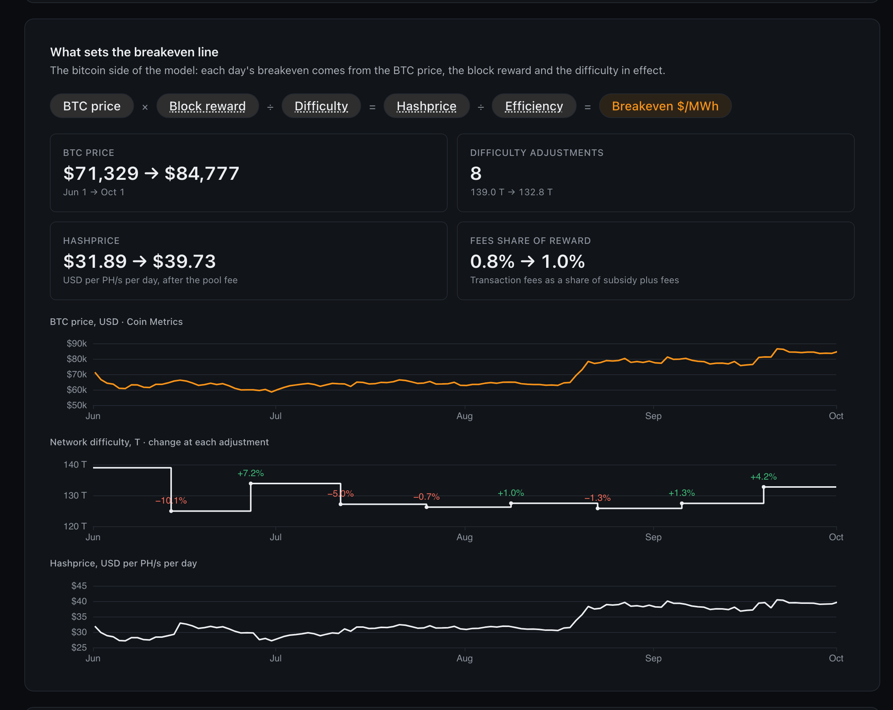

# Run or Rest

Backtests curtailment rules for a bitcoin mining fleet on ERCOT West (LZ_WEST) real-time power prices, June to September 2026. It compares always on, strike price, and strike price plus a 4CP peak guard, and shows which made the most money and why. See [`SPEC.md`](SPEC.md).



Power price and load data provided by [Grid Status](https://www.gridstatus.io/).

## Get started

### Prerequisites

- uv 0.13.4
- Node 26
- GNU Make
- A [Grid Status](https://www.gridstatus.io/) API key

### Steps

1. Install dependencies: `make setup`
2. Add your API key: `cp .env.example .env`, then set `GRIDSTATUS_API_KEY` in `.env`
3. Fetch the ERCOT data: `make fetch`
4. Start the app: `make dev`, then open http://localhost:5173

## Scope and trade-offs

Choices made to keep the project small, for now:

- Runs locally only: no deployment, auth or monitoring.
- Data is a one-off snapshot fetched to local files, not a live feed.
- No caching: each request reruns the backtest (about 0.15 s). Only 21 thresholds are valid, so precomputing them is the obvious next step.
- Every request sends the full 15-minute series (about 2.2 MB) uncompressed. Gzip or downsampling would come next.
- The 4CP peaks come from Grid Status load data and haven't been checked against ERCOT's official intervals.
- The transmission rate is a round $50,000 per MW-year, not a specific utility's tariff.

Planned work is in [issues](https://github.com/johngribbin/run-or-rest/issues).

## How it works



Data loads once at startup. Each request reruns the backtest for the chosen peak guard threshold; nothing is cached or stored.

Each month's 4CP peak is the 15-minute interval with the highest system load in the Grid Status data. ERCOT publishes the official 4CP intervals once a year ([NP9-83-M](https://www.ercot.com/mp/data-products/data-product-details?id=np9-83-m)); these peaks have not yet been checked against it.

The page also shows where the breakeven line comes from: BTC price, difficulty and hashprice over the season.



BTC price data from [Coin Metrics](https://coinmetrics.io/), licensed under [CC BY-NC 4.0](https://creativecommons.org/licenses/by-nc/4.0/).

## Where the logic lives

The backend is a [functional core, imperative shell](https://www.destroyallsoftware.com/screencasts/catalog/functional-core-imperative-shell). Every calculation and decision is a pure function in [`core/`](backend/src/run_or_rest/core/), with no I/O, no clock and no HTTP; [`data/`](backend/src/run_or_rest/data/) and [`api/`](backend/src/run_or_rest/api/) are the shell that reads the files and serves the results. The frontend is a thin client: no math, no policy, just rendering. Money, prices, load and difficulty are `Decimal`, never floats.

The core, in reading order:

- [`backtest.py`](backend/src/run_or_rest/core/backtest.py): settles every interval, totals each rule, splits each gain into price and 4CP, and picks the winner.
- [`context.py`](backend/src/run_or_rest/core/context.py): builds what the miner knew at the start of each 15-minute interval: the last price, the last load, and a breakeven estimate from the previous day's BTC price and block rewards. Strategies only ever see this, so a backtest can't peek at the price it is deciding on.
- [`strategies.py`](backend/src/run_or_rest/core/strategies.py): the three rules, as plain functions that return run or off.
- [`peaks.py`](backend/src/run_or_rest/core/peaks.py): finds each month's 4CP peak and prices the transmission charge.
- [`economics.py`](backend/src/run_or_rest/core/economics.py): hashrate, expected blocks, mining revenue, energy cost, breakeven price, hashprice, and difficulty from a block's `bits`.

The shell and the client:

- [`data/files.py`](backend/src/run_or_rest/data/files.py) reads the files with Polars and rejects any malformed row by file and row number.
- [`api/mapping.py`](backend/src/run_or_rest/api/mapping.py) maps core's results to the response and rounds them; it calculates nothing.
- [`frontend/src/format.ts`](frontend/src/format.ts) formats the API's decimal strings for display without turning them into floats.

## Tech stack

- Backend: Python 3.13, uv, FastAPI, Pydantic, Polars
- Frontend: React 19, TypeScript, Vite, Mantine, TanStack Query, ECharts
- Data: Grid Status (ERCOT prices and load), a Bitcoin Core node (blocks and difficulty), Coin Metrics (BTC price)

## Working with agents

The project was built spec first: `SPEC.md` defines the behaviour, tests encode it, and code makes the tests pass. `AGENTS.md` holds the rules an agent follows.

An agent works on a branch, opens a PR, and can merge it itself once CI passes. A PR that touches a human-owned file waits for the owner's review: `SPEC.md`, `AGENTS.md`, `CLAUDE.md`, this README, the Makefile, `.github/`, every lint, type and test config, the lockfiles and the guardrail tools. `.github/CODEOWNERS` lists them, and the `main` ruleset requires code-owner review and a passing `verify-ci` check, merges by squash only, and blocks force pushes.

CI runs `make verify-ci`, which fails on any of these:

- Ruff with every rule enabled, and complexity above 10
- Pyright strict, with `Any` and `cast` banned
- TypeScript strict and typescript-eslint strict, with `any` and type assertions banned
- Any comment, docstring or lint suppression, in Python or TypeScript
- A source or test file over 400 lines
- Backend branch coverage below 100%
- A CRAP score above 10
- Generated API types out of date with the backend
- Unformatted code, a failing build or an empty test run; tests never retry and stop at the first failure

Each guardrail has its own test. A canary file with one deliberate violation runs through the real tool, and the test fails if the tool lets it pass, so a loosened config can't slip through.

## Check

```sh
make verify       # lint, format, types, source rules, tests
make verify-ci    # what CI runs
```

## Bitcoin data

Bitcoin chain data and BTC price history are committed to `data/`, so you don't need to fetch them to run the app. To fetch them again, the price history comes from the Coin Metrics Community API (no key needed), and the chain data needs a fully synced Bitcoin Core node with RPC access:

```sh
cd backend
uv run python -m scripts.fetch_price
BITCOIN_RPC_URL=… BITCOIN_RPC_USER=… BITCOIN_RPC_PASSWORD=… \
  uv run python -m scripts.fetch_chain
```

## Roadmap

Planned improvements and known issues are tracked as [GitHub issues](https://github.com/johngribbin/run-or-rest/issues). Ideas for later carry the [`later`](https://github.com/johngribbin/run-or-rest/labels/later) label; known bugs carry [`bug`](https://github.com/johngribbin/run-or-rest/labels/bug).
